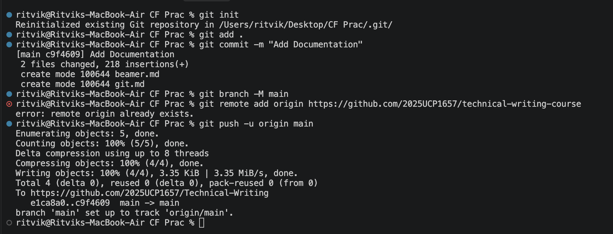

These are the commands used to add files on in the GitHub Repositry.

**Commands Used**
```bash
git init
git add
git commit -m "Add Documentation"
git branch -M main
git remote add origin https://github.com/2025UCP1657/technical-writing-course
git push -u origin main


