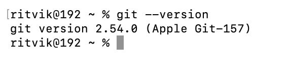
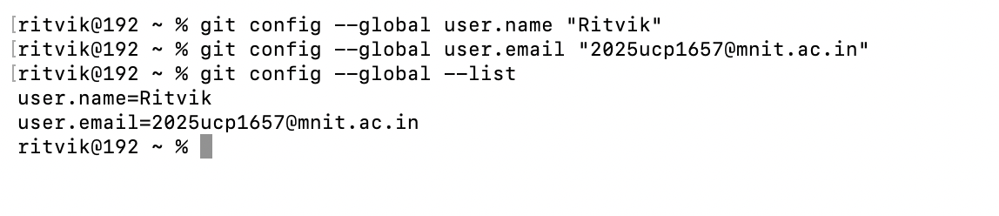
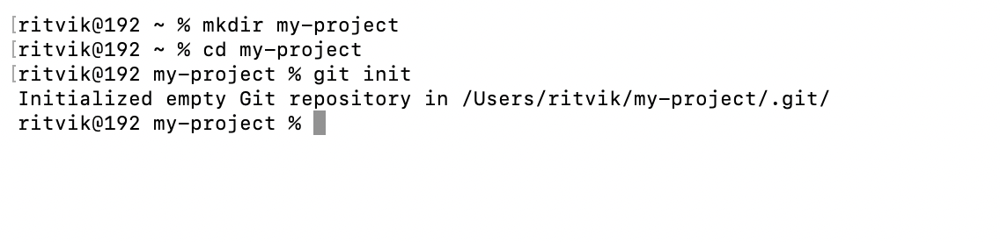

## 1. Introduction to Version Control

Version control is a system used to maintain a record of changes made to files over a period of time.

**Key Features:**
- Keeps track of modifications made to files.
- Records the person responsible for each change and the time it was made.
- Allows users to recover earlier versions whenever required.
- Makes collaboration between multiple contributors easier.

**Common Problems Without Version Control:**
- Files can be accidentally replaced or overwritten.
- Earlier working versions may become unavailable.
- Identifying the reason behind an error can be difficult.
- Integrating contributions from different team members becomes challenging.

**Key Idea:** Version control helps maintain an organized record of changes and makes it easier to manage the history of a project.

## 2. Types of Version Control Systems

Version control systems are generally divided into three major categories:

1. **Local Version Control:** Maintains different versions of files directly on a user's computer.
2. **Centralized Version Control:** Keeps project versions on a central server. Example: SVN.
3. **Distributed Version Control:** Provides every user with a complete copy of the repository. Example: Git.

## 3. Git: Introduction

Git is a distributed version control system that helps developers monitor and manage changes made to project files.

- Maintains a record of changes within a project.
- Preserves project history through commits.
- Provides branches for working on different features independently.
- Enables developers to work without an internet connection.
- Makes it easier to integrate changes contributed by multiple developers.

## 4. How Git Works

Git follows a workflow consisting of three major stages:

1. **Working Directory:** The location where project files are created, edited, or modified.
2. **Staging Area:** The intermediate area where selected changes are prepared before committing.
3. **Repository:** Maintains committed changes along with the complete project history.

## 5. Git Architecture

Git architecture mainly consists of the following three components:

1. **Working Directory:** Contains the files and folders of the project being worked on.
2. **Local Repository:** Maintains project changes and commit history on the user's computer.
3. **Remote Repository:** Hosts the project online and provides a platform for collaboration.

## 6. Installing and Verifying Git

Git is available for different operating systems, including Windows, Linux, and macOS.

**Verify Git Installation:**

The following command can be executed in the terminal to confirm whether Git has been installed successfully:

```bash
git --version
```

**Git Version:**



## 7. Configuring Git

Before starting to work with Git, it is necessary to configure the user's name and email address.

**Set Username, Email and Verify Configuration:**

```bash
git config --global user.name "Student Name"
git config --global user.email "student@example.com"
git config --global --list
```

**Name and Email:**



## 8. Creating a Git Repository

A Git repository is used to maintain project files and keep track of their modification history.

**Steps to Initialize a Repository:**

```bash
mkdir my-project
cd my-project
git init
```



## 9. Basic Git Workflow

The basic Git workflow consists of several commands that help manage changes and save them in the repository.

| Command | Purpose |
|---|---|
| `git status` | Displays the current state of the repository. |
| `git add .` | Adds all modified and new files to the staging area. |
| `git commit -m "message"` | Records the staged changes in the repository. |
| `git push` | Transfers local commits to a remote repository. |

These commands are commonly used to organize project modifications and maintain their history.

## 10. Important Git Commands

The following table contains some commonly used Git commands along with their functions.

| Command | Purpose |
|---|---|
| `git --version` | Displays the currently installed Git version. |
| `git config --global user.name "Name"` | Configures the username for Git. |
| `git config --global user.email "email"` | Sets the email address associated with Git. |
| `git config --global --list` | Shows all configured Git settings. |
| `mkdir my-project` | Creates a new project directory. |
| `cd my-project` | Moves into the specified directory. |
| `git init` | Creates a new Git repository. |
| `git status` | Displays the current repository status. |
| `git add main.py` | Adds a particular file to the staging area. |
| `git add .` | Stages all changes in the current directory. |
| `git commit -m "message"` | Saves staged modifications as a commit. |
| `git log` | Shows the complete commit history. |
| `git log --oneline` | Displays commit history in a compact format. |
| `git diff` | Displays changes that have not been staged. |
| `git diff --staged` | Displays changes currently present in the staging area. |
| `git diff HEAD` | Shows all changes made since the most recent commit. |
| `git ls-files` | Displays the list of tracked files. |
| `git mv old.py new.py` | Renames or moves a file tracked by Git. |
| `git rm old.py` | Deletes a tracked file from the repository and working directory. |
| `git restore --staged main.py` | Removes a file from the staging area. |
| `git restore main.py` | Discards unstaged modifications made to a file. |
| `git revert COMMIT_ID` | Creates a new commit to undo the changes introduced by an earlier commit. |
| `git remote -v` | Lists the remote repositories connected to the project. |
| `git remote add origin URL` | Adds a remote repository with the name origin. |
| `git branch` | Lists the available branches. |
| `git branch feature-login` | Creates a new branch named feature-login. |
| `git switch feature-login` | Changes the current branch to feature-login. |
| `git switch -c feature-login` | Creates a new branch and switches to it. |
| `git merge feature-login` | Integrates the feature-login branch into the current branch. |
| `git branch -M main` | Renames the current branch to main. |
| `git push -u origin main` | Pushes commits to the remote main branch and sets its upstream. |
| `git push` | Sends local commits to the configured remote repository. |
| `git clone URL` | Creates a local copy of a remote repository. |
| `git fetch origin` | Retrieves remote updates without integrating them into the current branch. |
| `git pull` | Fetches remote updates and integrates them into the current branch. |

## 11. Conclusion

Git is a widely used version control system that enables developers to monitor changes and maintain their projects effectively.

It offers useful features such as commits, branching, merging, and collaboration. These capabilities help make the software development process more structured, manageable, and dependable.
