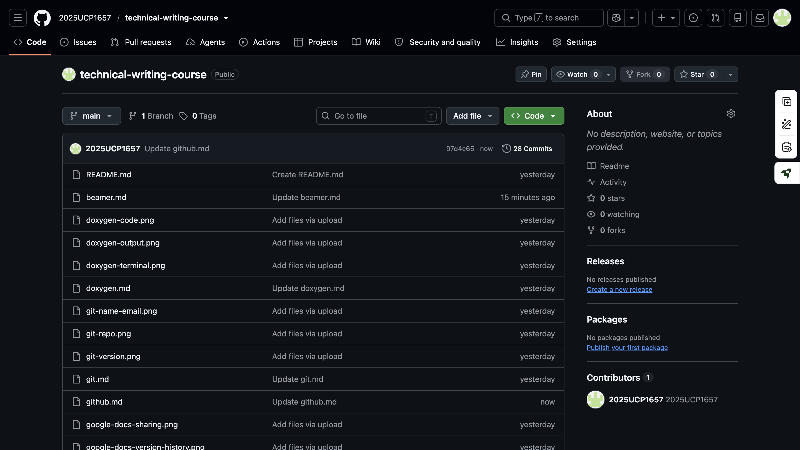

# 1. Introduction to GitHub

GitHub is an online platform that allows developers to store Git repositories, manage projects, and work together on software development.

**Key Features:**
- Provides online storage for project code.
- Enables collaboration among developers.
- Maintains a record of project changes.
- Makes it easier to share projects.
- Offers useful tools such as Issues and Pull Requests.



## 2. GitHub Repository

A GitHub repository is an online space where all project files and their version history are stored and managed.

**Key Points:**
- Stores project files on the internet.
- Keeps track of changes made to the project.
- Allows multiple developers to collaborate.
- Repositories can be either public or private.

**Steps to Create a Repository:**
1. Visit GitHub and select **New Repository**.
2. Provide a suitable name for the repository.
3. Select either Public or Private visibility.
4. Add a README file if required.
5. Click on **Create Repository** to finish.

## 3. README File

A README file acts as an introduction to a project and provides essential details about it.

**It generally includes:**
- Project name and overview.
- Main features and functionalities.
- Steps for installation.
- Instructions for using the project.
- Information about contributors.
- License and usage details.

GitHub automatically displays the README file on the homepage of a repository, making it easier for visitors to understand the project.

## 4. Connecting a Local Repository to GitHub

A repository stored on a local computer can be linked to a remote GitHub repository using the following command:

```bash
git remote add origin https://github.com/USERNAME/repository.git
```

This command sets the GitHub repository as the remote destination named `origin`.

## 5. Uploading Code to GitHub

The `git push` command is used to send locally committed changes to a remote GitHub repository.

**Commands:**

```bash
git branch -M main
git push -u origin main
```

These commands rename the current branch to `main` and upload it to GitHub.

## 6. Cloning a GitHub Repository

Cloning is the process of downloading a complete local copy of an existing GitHub repository, including its files and version history.

**Command:**

```bash
git clone https://github.com/USERNAME/repository.git
```

This command creates a local copy of the specified repository.

## 7. Branches in GitHub

A branch represents a separate path of development within a Git repository. It allows developers to work on different features independently.

**Key Points:**
- The `main` branch generally contains the stable version of the project.
- Separate branches can be created to develop new features.
- Developers can make changes without modifying the main branch directly.
- Completed changes can be merged into the main branch.

## 8. Pull Request

A Pull Request (PR) is a GitHub feature that allows developers to suggest changes and request a review before adding them to another branch.

**Steps to Create a Pull Request:**
1. Create a separate branch.
2. Make the required modifications.
3. Push the branch to GitHub.
4. Create a Pull Request.
5. Review the proposed changes.
6. Merge the Pull Request after approval.

## 9. GitHub Issues

GitHub Issues is a feature used to identify, discuss, and manage bugs, tasks, and new feature suggestions within a project.

**Key Features:**
- Helps developers report errors and bugs.
- Allows users to suggest additional features.
- Makes it possible to assign tasks to team members.
- Helps monitor discussions and project development.

## 10. Forking a Repository

Forking means creating an independent copy of an existing repository under your own GitHub account.

**Key Points:**
- Creates a separate copy of another user's repository.
- Allows modifications without affecting the original project.
- Provides an opportunity to contribute to external projects.
- Changes can be suggested to the original repository through a Pull Request.

## 11. GitHub Projects

GitHub Projects is a project management feature that helps developers organize tasks and monitor the progress of their work.

**Key Features:**
- Helps arrange and manage project tasks.
- Provides an overview of project progress.
- Makes work planning more systematic.
- Improves coordination among team members.

## 12. Git Best Practices

Following good Git practices helps maintain a clean and well-organized repository.

- Use meaningful and descriptive commit messages.
- Save changes through commits at regular intervals.
- Create separate branches for different features.
- Check and review code before merging.
- Maintain a proper folder and file structure.
- Never expose passwords or access tokens.
- Avoid uploading confidential or sensitive information.

## 13. Conclusion

GitHub is a useful platform for storing source code, maintaining project history, and collaborating with other developers.

Its features, including repositories, branches, Pull Requests, Issues, Forks, and Projects, help make software development more structured, manageable, and efficient.
