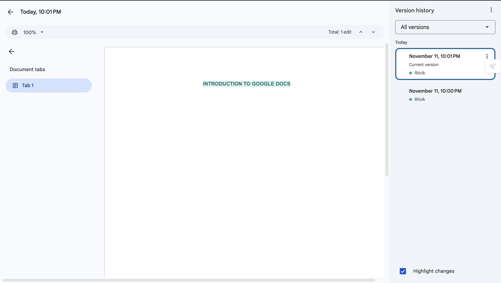
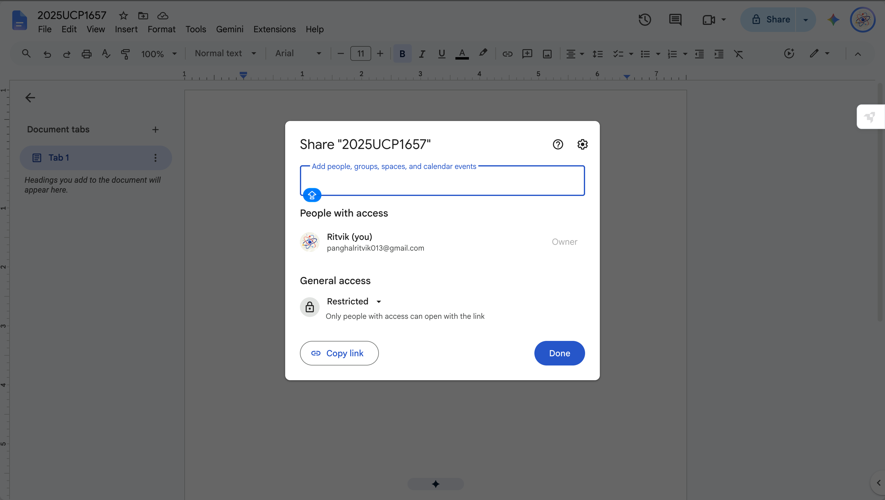
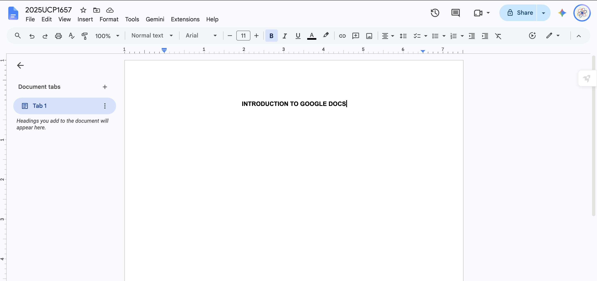

# Google Docs
### A Cloud-Based Tool for Document Creation and Collaboration

## 1. Introduction
Google Docs is an online word-processing tool developed by Google.

Unlike traditional offline word processors, Google Docs enables users to create, edit, and access documents through the internet on multiple devices. All changes are automatically saved.

It also supports real-time collaboration, allowing several users to work on the same document at the same time.

Google Docs is widely used in educational, professional, and collaborative settings for creating reports, assignments, and technical documents.

## 2. Purpose of Google Docs
The main objective of Google Docs is to make document creation, editing, and collaboration more convenient.

Its key purposes include:
- Creating and modifying digital documents.
- Arranging information with the help of headings, paragraphs, tables, and lists.
- Sharing documents with other users.
- Receiving feedback through comments and suggested edits.
- Keeping track of earlier versions of documents.
- Accessing files from different devices.

## 3. Important Characteristics
Google Docs offers several features that make it an effective tool for preparing documents:

1. **Cloud-Based Platform:** Documents are stored online and can be accessed from anywhere using different devices.
2. **Automatic Saving:** All modifications are saved automatically without requiring manual saving.
3. **Real-Time Collaboration:** Multiple users can edit the same document simultaneously.
4. **Formatting Options:** Provides various tools to improve the structure and appearance of documents.
5. **Sharing and Permissions:** Users can decide whether others can view, comment on, or edit their documents.

## 4. Document Formatting
Google Docs offers a variety of formatting options to make documents well-structured and easy to read.

- **Text Formatting:** Allows users to modify font styles, sizes, colours, and text alignment.
- **Headings:** Provides predefined heading styles to divide content into different sections.
- **Lists:** Supports bulleted and numbered lists for presenting information systematically.
- **Tables:** Helps organise data into rows and columns.
- **Page Layout:** Allows users to modify margins, page orientation, headers, and footers.

## 5. Collaboration and Sharing
One of the most useful features of Google Docs is its ability to support teamwork through online collaboration.

It provides different access levels:

- **Viewer:** Allows users to open and read the document without making changes.
- **Commenter:** Allows users to view the document and leave comments.
- **Editor:** Gives users permission to modify the document directly.
- **Suggesting Mode:** Enables users to propose changes without directly modifying the original content.
- **Comments:** Makes it easier for collaborators to discuss content and provide feedback.

## 6. Version History
Google Docs automatically records changes made to a document and maintains its previous versions.

Important features include:
- Navigate to **File → Version history → See version history**.
- Review modifications made to the document at different times.
- Recover an older version whenever required.
- Rename specific versions to identify important stages of the document.

## 7. Inserting Elements
Google Docs supports the addition of various elements to improve the presentation and organisation of documents.

- **Images:** Users can add pictures from their computer, Google Drive, or the web.
- **Tables:** Used to present information in an organised row-and-column format.
- **Drawings:** Allows users to create basic diagrams and illustrations.
- **Equations:** Provides options for adding mathematical expressions and formulas.
- **Lists:** Bulleted and numbered lists help present information in a structured manner.

## 8. Citations and References
Google Docs includes a built-in citation feature that is helpful for academic and research-based writing.

The process involves:
- Open **Tools → Citations**.
- Select the required citation format, such as APA, MLA, or Chicago.
- Enter the necessary details about the source.
- Add in-text citations and automatically create a bibliography.

## 9. Exporting Documents
Google Docs provides the option to download documents in several file formats according to the user's requirements.

Commonly supported formats include:
- **PDF:** Suitable for printing and sharing documents while preserving their layout.
- **DOCX:** Allows documents to be opened and edited in Microsoft Word.
- **ODT:** Compatible with OpenDocument-based word processors.
- **HTML:** Useful for publishing document content on websites.
- **TXT:** Stores document content as plain text without advanced formatting.

## 10. Best Practices
To prepare clear, professional, and well-organised documents in Google Docs, users should follow these practices:

- Apply appropriate heading styles to structure the content.
- Maintain uniform fonts, sizes, and formatting throughout the document.
- Use comments and suggestions to manage feedback during collaboration.
- Review spelling and grammar before finalising the document.
- Preserve important versions to avoid losing significant changes.

## 11. Conclusion
Google Docs is an efficient online platform for creating, editing, formatting, and sharing digital documents.

Its cloud storage, automatic saving, collaboration tools, and version history features make document management easier and more convenient. As a result, it serves as a valuable tool in both academic and professional environments.
